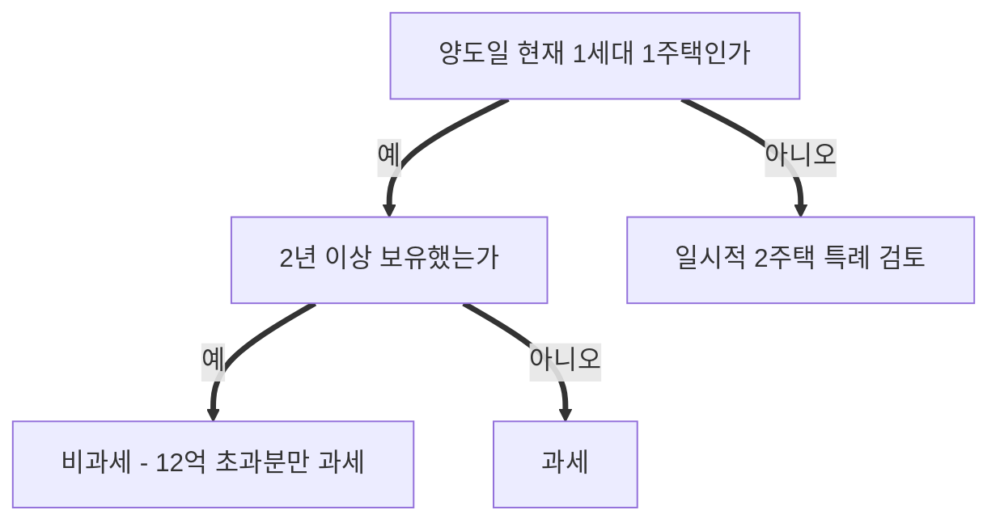

<div class="letterhead"><div class="brand">이음세무컨설팅 NETAX</div><h1>자문보고서</h1></div>

<table class="meta">
<tr><td class="k">수신</td><td>⚠[확인필요: 고객명] 님</td></tr>
<tr><td class="k">발신</td><td>이음세무컨설팅 조종호 세무사</td></tr>
<tr><td class="k">작성일</td><td>⚠[확인필요: 작성일]</td></tr>
<tr><td class="k">검토대상</td><td>⚠[확인필요: 사건명]</td></tr>
<tr><td class="k">법정신고기한</td><td>⚠[확인필요: 법정신고기한 — 해당 없으면 이 줄 삭제]</td></tr>
</table>

<!-- 작성 안내(화면에 안 보임) — 고객이 직접 읽는 외부 문서입니다.
· 본문에 실명을 쓰지 않습니다: 고객님·배우자·자녀 갑/을, 매수인 A처럼. (수신란의 고객명은 그대로)
· 조건에 따라 결과가 갈리면 Mermaid 순서도, 대안별 세액 비교는 compare 막대로 보여 줍니다. 같은 숫자를 표로 또 보여 주면 막대는 뺍니다.
· 조문은 본문에 길게 쓰지 말고 각주로: 문장 끝에 꺾쇠 각주 표시(대괄호+^+번호), 문서 끝에 같은 표시와 콜론 뒤 조문 — 맨 끝 각주 줄 참고(대괄호 앞에 역슬래시 금지)
· 알림상자(> ✅ / > ⚠️ / > ℹ️)는 절의 최종 결론에만, 절마다 1~2개.
· 항목-값 한 쌍 표는 2열 세로 표로. 문서 끝에 인터넷 주소(URL)를 넣지 않습니다.
· 어조: 세무사님이 직접 설명하듯 자연스럽게 — "~입니다/~하시면 됩니다". 과장·상투어 금지.
Mermaid 예시(노드 글은 한 줄, 한글 묶음 이름은 따옴표):

compare 예시(이름: 숫자):
```compare
지금 양도: 48000000
거주 2년 채운 뒤 양도: 12000000
```
-->

## 검토개요

✍️[AI 작성: 고객님이 물어보신 것과 이 보고서가 답하는 범위를 2~3문장으로 — 예: 보유하신 주택을 올해 양도할 때의 양도소득세와, 자녀에게 증여한 뒤 양도하는 방법을 비교했습니다]

## 핵심결론 (한눈에 보기)

| 항목 | 내용 |
|---|---|
| 결론 | ✍️[AI 작성: 한 문장 결론] |
| 예상 세액 | ⚠[확인필요: 최종세액] |
| 꼭 지키실 것 | ✍️[AI 작성: 기한·요건 등 고객이 반드시 지켜야 할 한 가지] |
| 추가로 필요한 자료 | ✍️[AI 작성: 결론을 확정하는 데 남은 자료 — 없으면 "없음"] |

> ✅ ✍️[AI 작성: 고객님께 드리는 최종 권고 한두 문장]

## 문의사항별 답변

<!-- 고객님이 물으신 것이 여러 개면(복합 자문) 이 절을 씁니다. 하나뿐이면 이 절을 지웁니다.
· 문의 번호는 사건 장부 자문 칸 "문의"의 번호(문의 1, 문의 2…) 그대로, 고객님이 물으신 순서대로 씁니다.
· 문의마다 결론 한두 줄과 "쟁점 ○ 참조"만 씁니다. 풀이는 아래 쟁점별 검토에만 둡니다(같은 설명을 두 번 쓰지 않음).
· 답을 못 낸 문의는 지우지 말고 "보류 — 까닭(필요한 자료)"으로 남깁니다. 표의 문의 수는 장부 문의 수와 같아야 합니다. -->

| 번호 | 세목 | 물으신 것 | 답 | 자세히 |
|---|---|---|---|---|
| 1 | ✍️[AI 작성: 양도/증여/상속] | ✍️[AI 작성: 고객님 문의를 한 줄로] | ✍️[AI 작성: 결론 한두 줄 — 답을 못 내면 "보류 — 까닭"] | 쟁점 ○ 참조 |

## 사실관계

<!-- 고객님이 주신 자료로 확인한 사실만 씁니다. 확인 못 한 것은 "(고객님 말씀 기준, 서류 확인 전)"으로 표시합니다. -->

| 항목 | 내용 |
|---|---|
| 대상 재산 | ✍️[AI 작성: 소재지(동·지번까지 필요 없으면 시·구까지)·종류·면적] |
| 취득 | ✍️[AI 작성: 취득일·취득원인·취득가액] |
| 가족·세대 | ✍️[AI 작성: 세대 구성과 다른 주택 보유 여부 — 실명 대신 갑·을] |
| 예정 거래 | ✍️[AI 작성: 양도·증여 예정일과 예정 가액] |

```timeline
⚠[확인필요: 날짜] : ✍️[AI 작성: 취득·전입·계약·잔금 등 주요 사건]
```

---

## 쟁점별 검토

<!-- 📚 쟁점 문단으로 넣은 내용을 고객용 말투로 다듬습니다. 쟁점이 하나면 소제목 하나만 남깁니다. -->

### ✍️[AI 작성: 쟁점 1 — 고객이 이해하는 말로, 예: 비과세를 받을 수 있는지]

✍️[AI 작성: 요건을 하나씩, 고객님의 경우 충족 여부와 이유. 조문은 각주로]

### ✍️[AI 작성: 쟁점 2]

✍️[AI 작성: 내용]

## 세액 계산 (해당하는 경우)

<!-- 계산기 칸 이름 그대로. 대안 비교가 있으면 대안별 열을 둡니다. -->

| 구분 | ✍️[AI 작성: 안 1] | ✍️[AI 작성: 안 2] |
|---|---|---|
| ⚠[확인필요: 세액계산 결과 칸] | | |
| 납부할 세액 | | |

✍️[AI 작성: 숫자를 한두 문장으로 풀어 설명 — 어느 안이 얼마나 유리한지, 그 이유]

## 실수령액과 자금 흐름 (해당하는 경우)

<!-- [2026.10.21 세무사님: "자문할때 실수령액에 따른 자금흐름을 검토하고는 있다"] 세금만이 아니라 고객님 손에 실제로 남는 돈과, 돈이 들어오고 나가는 날짜를 함께 보여 드립니다.
· 양도: 받으실 돈에서 세금·비용·갚으실 돈을 뺍니다. 증여·상속: 세금을 낼 돈을 누가, 어디서, 언제 마련하는지 봅니다. 해당 없는 줄은 지웁니다.
· 세금 줄은 위 "세액 계산" 표의 납부할 세액과 같은 숫자여야 합니다(다르면 다시 계산).
· 중개보수·대출 상환액처럼 NETAX가 계산하지 않은 금액은 고객님께 받은 숫자만 쓰고 "(고객님 말씀 기준)"으로 표시합니다. 모르는 칸은 비워 두고 "준비 및 확인 필요사항"에 올립니다.
· 양도소득세 예정신고·납부 기한은 양도일이 속하는 달의 말일부터 2개월입니다(소득세법 §105①1호 — 부담부증여의 채무 부분은 3개월, 같은 항 3호). -->

| 구분 | ✍️[AI 작성: 안 1] | ✍️[AI 작성: 안 2] |
|---|---|---|
| 받으실 돈 (양도대금 등) | | |
| − 세금 (양도소득세·증여세·상속세) | | |
| − 지방소득세 | | |
| − 중개보수·법무 비용 등 | | |
| − 대출·전세보증금 등 갚으실 돈 | | |
| **= 손에 남는 돈 (실수령액)** | | |

```timeline
⚠[확인필요: 날짜] : ✍️[AI 작성: 계약금·중도금·잔금이 들어오는 날, 대출을 갚는 날]
⚠[확인필요: 신고·납부기한] : ✍️[AI 작성: 세금을 내시는 날과 금액]
```

✍️[AI 작성: 돈이 들어오기 전에 세금 낼 날이 오는지, 세금 낼 돈을 어디서 마련하시는지(다른 사람이 대신 내 주는 경우는 그 돈이 다시 증여가 되는지 따로 검토), 실수령액으로 하시려는 일(대출 상환·다른 집 취득 등)에 모자람이 없는지 — 고객님 경우에 해당하는 것만]

---

## 준비 및 확인 필요사항 (우선순위순)

- ① ✍️[AI 작성: 가장 먼저 하실 일 — 무엇을, 어디서, 언제까지]
- ② ✍️[AI 작성: 다음 할 일]

## 다음 절차 / 실행 로드맵

| 시점 | 할 일 | 맡는 사람 |
|---|---|---|
| ✍️[AI 작성: 날짜·기한] | ✍️[AI 작성: 계약·잔금·신고·납부 등] | 고객님 / NETAX |

> ⚠️ ✍️[AI 작성: 일정상 가장 주의할 점 하나 — 예: 잔금일이 ○월 ○일을 넘기면 특례 기한이 지납니다]

*본 보고서는 제시된 사실관계를 기초로 작성된 세무 자문 의견입니다. 위 확인 필요사항이 확정되는 대로 재검토가 필요하며, 최종 실행 전 법령 변동 여부를 반드시 확인하시기 바랍니다.*

<div class="signline">⚠[확인필요: 작성일]<br><span class="name">이음세무컨설팅 세무사 조종호</span></div>

[^1]: ✍️[AI 작성: 근거 조문 — 법률명 §조번호(조문 제목)]
